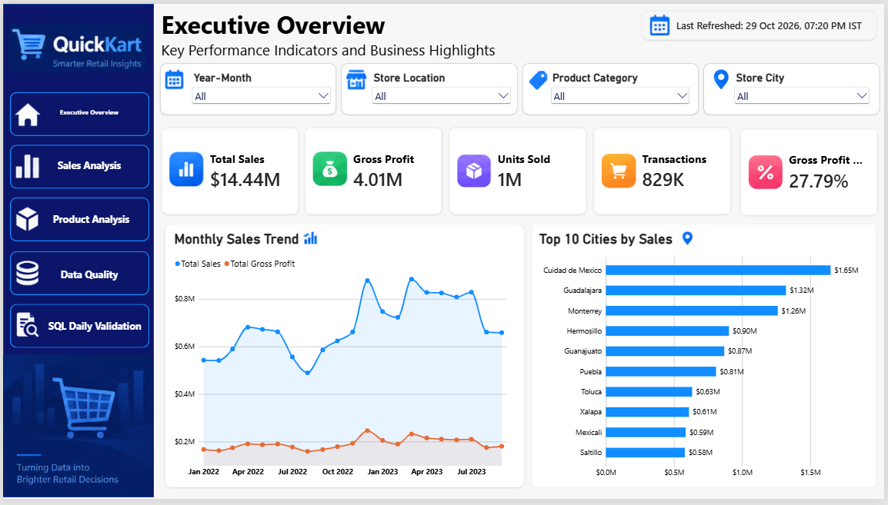
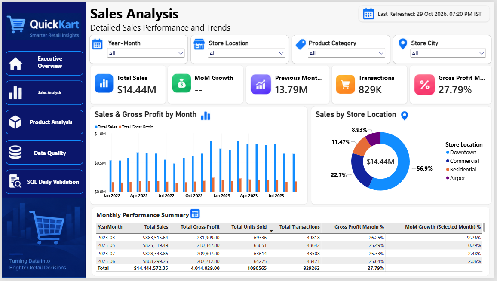
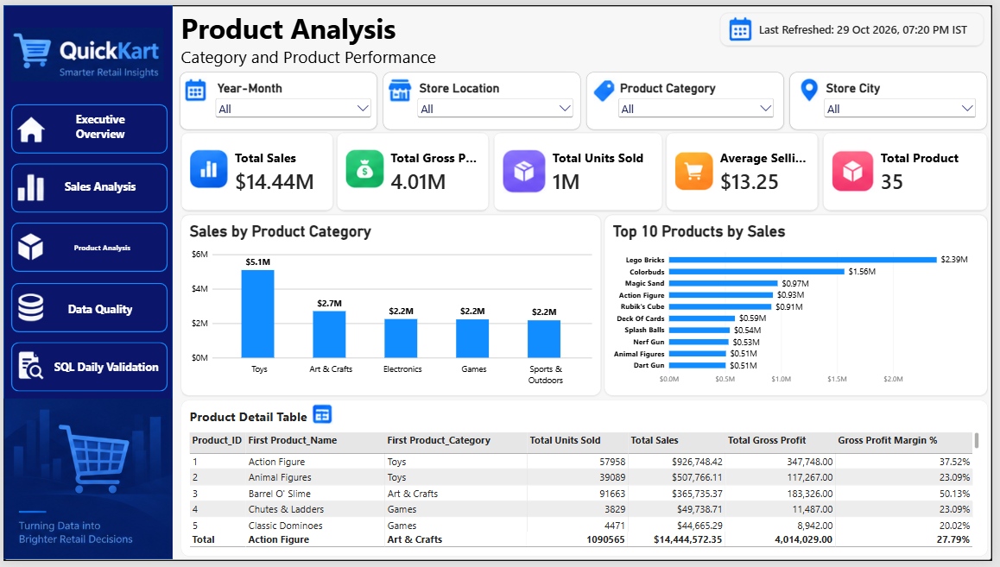
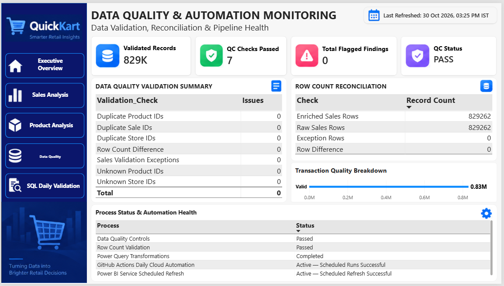
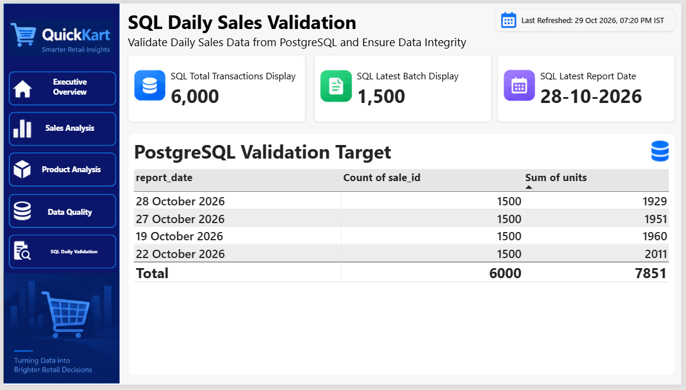

QuickKart | End-to-End Retail Analytics & Cloud Automation
SQL • PostgreSQL • Python • Power BI • DAX • Power Query • Advanced Excel • GitHub Actions • Business Analysis
> An end-to-end retail analytics portfolio project combining historical business analysis with a scheduled, cloud-based pipeline for **simulated** daily point-of-sale (POS) transactions.
Project at a glance
Historical retail analytics	Daily cloud pipeline
829,262 historical sales records	50 simulated stores
$14.44M total sales	1,500 simulated transactions per daily batch
$4.01M gross profit	Automated data-quality checks and PASS/BLOCKED approval
27.79% gross profit margin	Neon PostgreSQL + Power BI Service scheduled refresh
5 Power BI report pages	15 documented UAT test cases
Cloud snapshot (30 October 2026): 7,500 approved daily transactions and 9,852 units across five approved report dates. This is a point-in-time snapshot; the running dataset grows with subsequent successful daily batches.
Business problem
Retail reporting becomes slow and error-prone when store-level files are collected manually, combined in spreadsheets, and checked without a consistent approval process. QuickKart demonstrates how an analyst can bring together business requirements, data validation, SQL analytics, and automated reporting in one workflow.
Solution and architecture
```text
50 simulated stores × 30 daily POS transactions
                  |
                  v
         GitHub Actions schedule
                  |
                  v
     Python POS generation + quality validation
                  |
        +---------+----------+
        |                    |
    INVALID DATA          VALID DATA
        |                    |
    BLOCKED status       PASS status
    Error/exception logs Approved batch
                             |
                             v
                    Neon PostgreSQL
                             |
                             v
                  Power BI Service refresh
                             |
                             v
                  SQL Daily Validation report
```
The historical business analysis and the simulated daily cloud pipeline are separate data streams. The historical KPI cards should not be confused with the growing daily approved-sales table.
Power BI dashboards
1. Executive Overview

Historical sales, gross profit, profit margin, transaction volume, sales trends, and city-level performance.
2. Sales Analysis

Retail sales exploration with time, store, location, and business filters.
3. Product Analysis

Category sales, product rankings, and product-level performance metrics.
4. Data Quality & Automation Monitoring

Historical row reconciliation, validation outcomes, and reported automation status.
5. SQL Daily Sales Validation

Neon PostgreSQL daily approved transactions, batch counts, report dates, and unit totals.
Data-quality controls
The Python workflow applies checks including:
Expected versus received store-file counts (50 expected)
Duplicate sale identifiers
Invalid transaction units and dates
Unknown store or product identifiers
PASS/BLOCKED outcomes, exception logs, and approved-output gating
Invalid batches are blocked from the approved output. Valid batches are processed for cloud reporting.
SQL and analytics
The `sql/` folder contains portfolio queries covering KPI reconciliation, city performance, product/category analysis, inventory stock risk, daily approved-sales structures, and outlier detection.
Python and cloud automation
`python/generate_cloud_store_files.py`: generates simulated daily store POS files.
`python/run_daily_quality_pipeline.py`: executes validation, records issues, and produces approved outcomes.
`automation/`: sanitized example workflow and scheduled-run screenshot. The active operational workflow is maintained separately from this public showcase repository.
The actual cloud workflow uses GitHub Actions, Neon PostgreSQL, and scheduled Power BI Service refresh. The local laptop does not need to run the daily cloud job.
Business analysis and UAT
The `business_analysis/` folder contains:
AS-IS manual reporting process diagram
TO-BE automated cloud reporting process diagram
Daily sales BPMN process diagram
Final business requirements and UAT workbook, documenting 15 test cases
UAT evidence includes original execution records and clearly identified isolated synthetic test results where historical screenshots were not available. Formal external stakeholder sign-off is not claimed.
Repository structure
```text
quickkart-retail-analytics-portfolio/
├── README.md
├── dashboard_screenshots/  # Five real Power BI page screenshots
├── sql/                    # PostgreSQL analysis and validation queries
├── python/                 # Simulated POS generation and quality pipeline
├── automation/             # Example workflow and scheduled-run evidence
└── business_analysis/      # Process maps and UAT workbook
```
What this project demonstrates
Data Analyst / BI Analyst: SQL, DAX, Power Query, dashboard design, business KPI reconciliation, and analytical storytelling.  
MIS / Reporting Analyst: report validation, repeatable daily batches, quality checks, and reporting automation.  
Business Analyst: AS-IS/TO-BE process mapping, requirements, traceability, and UAT evidence.
Notes and data transparency
The historical retail dataset is used for portfolio analysis; the daily 50-store POS feed is simulated, not a live commercial POS integration.
Displayed KPI figures and cloud transaction counts refer to their respective datasets and snapshot dates.
No database credentials or private connection strings are included in the public repository.
Dashboard screenshots and workflow evidence represent captured states; they are not live embedded monitoring widgets.
---
Created as an independent analytics portfolio project by Anaskhan1245.
